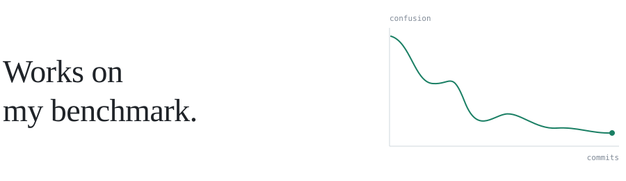

<picture>
  <source media="(prefers-color-scheme: dark)" srcset="assets/header-dark.svg">
  
</picture>

<samp>building at <a href="https://github.com/Oqura-ai">oqura</a></samp>

 

| <samp>now</samp> | |
|:--|:--|
| [**kanon-labs**](https://github.com/swadhin505/kanon-labs) | CI regression testing for AI agents |
| [**claude-dashboard**](https://github.com/swadhin505/claude-dashboard) | Local-first Claude Code usage and cost analytics |

| <samp>shipped</samp> | |
|:--|:--|
| [**deepdoc**](https://github.com/Oqura-ai/deepdoc) | Deep research over your local files |
| [**optim-jev**](https://github.com/Oqura-ai/optim-jev) | Jev-based decision tools for Claude Code and Codex |
| [**local-datagen-cli**](https://github.com/Oqura-ai/local-datagen-cli) | Synthetic datasets from local files for LLM fine-tuning |
